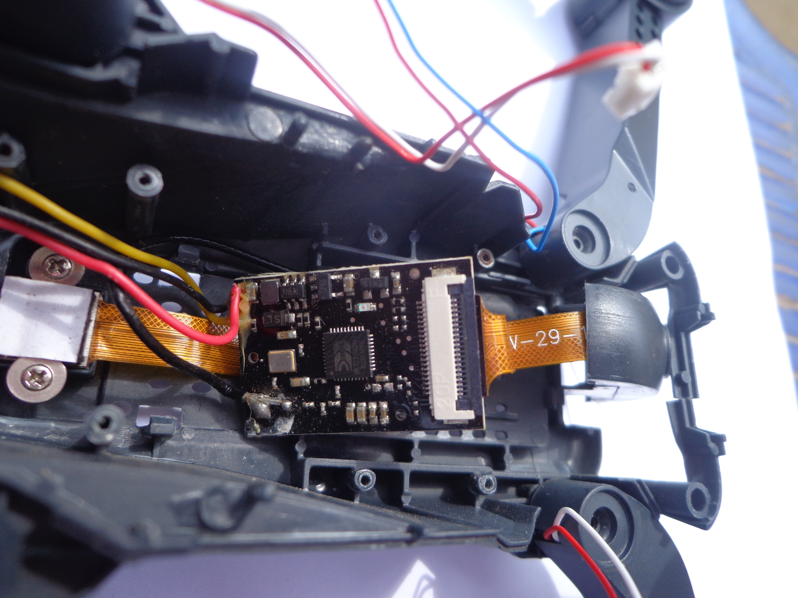

# E58 drone camera, salvaged

The camera board from an E58 toy drone, reverse-engineered and turned into a reusable Wi-Fi camera for a laptop. No reflashing and no hardware changes: the board keeps its stock firmware, and everything runs on the host.

I'm rebuilding the E58 around an ESP32-S3 and leaving its camera out, so the camera board became a project of its own.



## What the hardware is

- **Adapter board:** Beken BK7231U Wi-Fi chip, two cameras on 20-pin ribbon cables in flip-lock (ZIF) connectors. One camera streams at a time.
- **Power:** one Li-ion cell. 3.82 V measured on the drone's supply lead. Runs standalone from an 18650 through the red/black wires: 0.14 A idle, about 0.22 A streaming. The yellow wire isn't needed. **Never apply 5 V.**
- **Network:** the board runs its own access point (`WIFI_4K_*`, adapter at `192.168.4.153`, 2.4 GHz channel 1).

## What I found

- The protocol is UDP only. Sending `Bv` to port 8080 starts the stream; `By` toggles cameras. Video arrives as JPEG frames split across packets, with a length trailer for detecting damaged frames.
- The real resolution is **640 × 480**. The phone app's "4K" photos are upscaled.
- On a laptop, the stream runs at **about 20 fps**, against roughly 7.6 clean fps through the phone app.
- The board streams to **one receiver at a time**; whoever sends `Bv` last takes over.
- Switching cameras takes about 0.45 s. Camera 1 is active after power-up.
- The narrow, "zoomed" view comes from the lens, not app cropping.
- Damaged frames vary from about 0.5% to 20% depending on 2.4 GHz interference. The laptop itself drops nothing.

The full protocol, measurements and pitfalls are in [E58_CAMERA_INTEGRATION.md](E58_CAMERA_INTEGRATION.md).

## Quick start

Requirements: Python 3.9+ (tested on Linux; standard library sockets, so other systems should work). `opencv-python` and `numpy` are needed only for the viewer window and decoding; `ffmpeg` only for turning recordings into `.avi`.

1. Power the adapter (3.0–4.2 V) and wait for its Wi-Fi network to appear.
2. Connect the computer to `WIFI_4K_*`. Close the phone app, since it would take the stream.
3. Run one of the following.

**Video server** (recommended): one connection to the camera, shared over HTTP.
```
python3 e58_server.py
```
Open http://localhost:8081/ for a live view with switch, snapshot and record buttons. Other programs can use:

| Address | Gives |
|---|---|
| `/stream.mjpg` | MJPEG stream for browsers, VLC, OBS, `cv2.VideoCapture(url)` |
| `/snapshot.jpg` | latest raw 640 × 480 JPEG |
| `POST /switch` | toggle camera |
| `POST /record/start`, `POST /record/stop` | lossless recording into `captures/` (`.mjpg` + timestamps, wrapped to `.avi`) |
| `/status` | JSON: fps, frame counts, active camera, recording state |

Add `--host 0.0.0.0` to serve the stream to other devices on the network.

**Python library**, for your own code:
```python
from e58cam import E58Camera, decode_bgr

with E58Camera() as cam:
    cam.snapshot("photo.jpg")
    cam.switch_camera()
    for jpg, info in cam.frames():
        img = decode_bgr(jpg)   # 640x480 BGR, needs OpenCV
        ...
```

**Simple viewer window:**
```
python3 e58_viewer.py
```
Keys: `c` switch camera, `s` snapshot, `r` record, `q` quit.

## Files

| File | Purpose |
|---|---|
| [e58cam.py](e58cam.py) | Client library: stream, reassembly, frame checks, switch, snapshot, recording, auto-reconnect. Standard library only. |
| [e58_server.py](e58_server.py) | HTTP video server and control page built on `e58cam.py` |
| [e58_viewer.py](e58_viewer.py) | OpenCV viewer window |
| [probe_adapter.py](probe_adapter.py) | Network probe used to find the adapter's address and open ports |
| [E58_CAMERA_INTEGRATION.md](E58_CAMERA_INTEGRATION.md) | Drop-in guide for using the camera in another project. Written so a coding agent can read it and integrate the camera. Contains a full copy of `e58cam.py`. |
| [E58_camera_handover.md](E58_camera_handover.md) | Engineering log: hardware notes, measurements, decisions |
| `PCAPdroid_13_Nov_00_29_46.pcap` | Capture of the phone app's camera traffic (filtered to camera traffic only), used to work out the protocol |
| `logs/` | Output of the network probe |
| `*.jpg` | Photos of the adapter and drone frame |

## Using it in another project

Copy [E58_CAMERA_INTEGRATION.md](E58_CAMERA_INTEGRATION.md) into the new project. It explains the network setup, the protocol, how to map features (photo, recording, camera switch) to code, and the mistakes to avoid, and it includes the client library.

## Next

A machine-vision project: a person follower, with the camera mounted on servos that turn to keep a person in frame. The open question for that is end-to-end latency from the camera to the host, which hasn't been measured yet.

## Notes

- Built with Claude Code.
- This is a toy-drone part from a single unit. Other E58 variants may use different chips or protocols.
